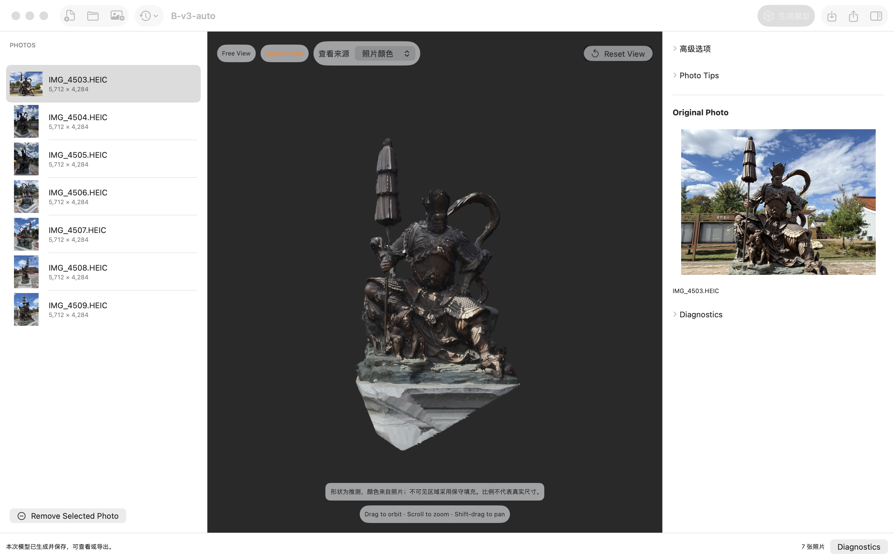
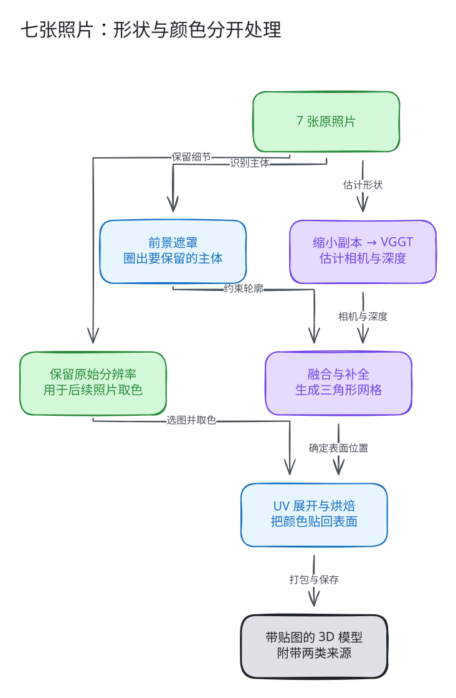
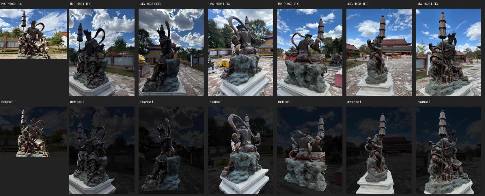
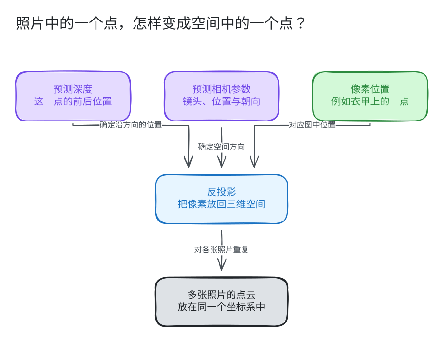
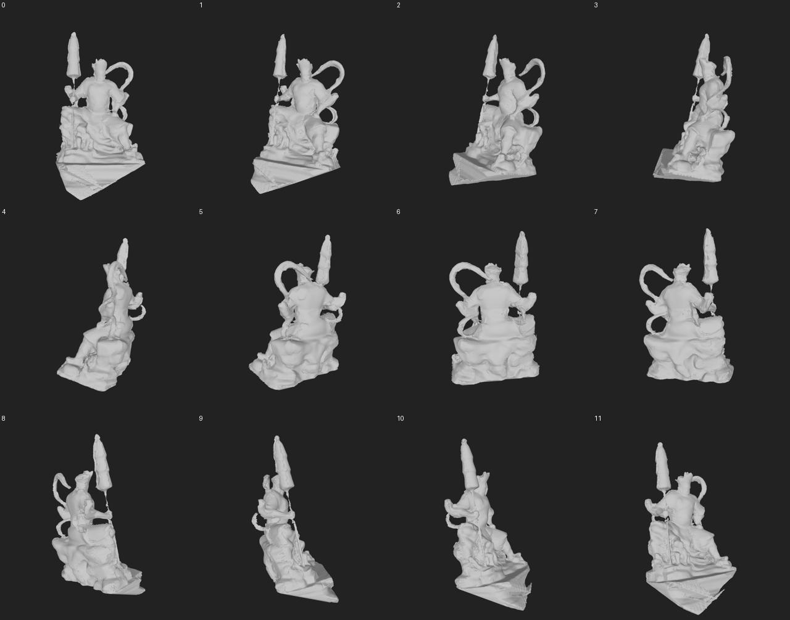
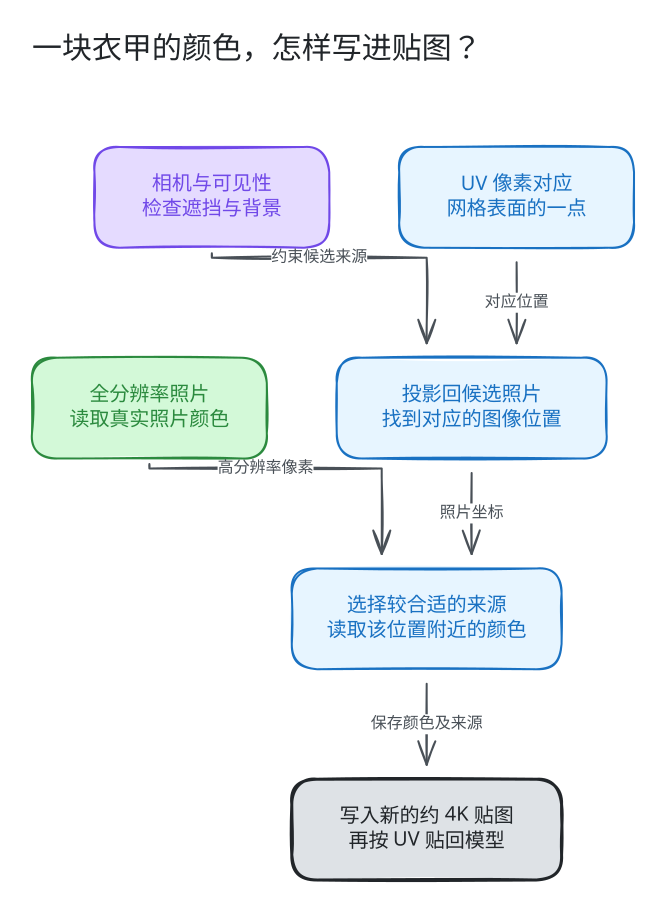
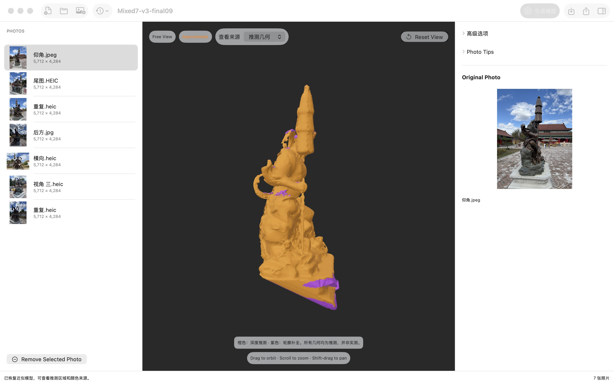
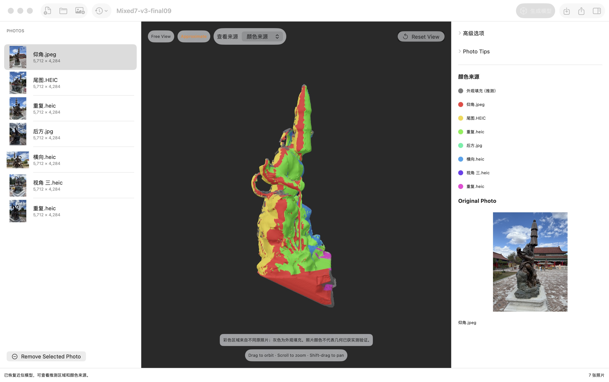

# 只有 7 张照片，怎样做出一个能旋转的 3D 佛像？

拿着手机绕一尊佛像拍了几张照片，回到电脑前，能不能把它变成一个可以旋转、从侧面和背面查看的三维模型？

Rebuild3D 已经用两套各 7 张的 iPhone HEIC 照片走通了这个过程：添加照片，点击生成，等待应用自动完成主体识别、形状重建和照片贴图，再保存或导出。

*图 1｜真实应用截图。左侧是七张输入照片，中间是生成的模型，右侧是原照片。细杆、面部和底座仍有粗糙或缺失，截图保留了这些问题。*

这里的关键是：**先估计物体的三维形状，再把原照片里的颜色放到这个形状上。** 少量照片没有拍清楚的地方，需要保守补全，并标明来源。

“7 张”是这次验证的输入数量，不是一个保证成功的神奇门槛。它们提供了多少不同角度、主体是否清晰、光照是否一致，都会影响结果。应用能生成一个可辨认的近似模型，也不等于把真实物体精确扫描了一遍。

> 本文面向第一次接触三维重建的读者，依据 2026-10-09 的 Rebuild3D v3 实现及 v0.1.0 阶段验收编写。技术说明对应代码基线 `9f394d1`。文中的“当前实现”“历史实验”“后续建议”分别标明；流程图是原理示意，照片和结果图来自本项目真实验收。

> 2026-10-11 更新：文末补充 v4 的量化、UV 优化、候选 09 的 12 次实际应用测试，以及候选 10 的调度、功能和十二次性能测试结果、候选 11 的启动优化进展。正文和原截图保留 v3 对应范围；v4 尚未完成整体验收，也未替换 v0.1.0 发布。

## 一、先认识模型的两部分：形状与颜色

可以把三维模型想成一件待上色的雕塑。

**形状叫作几何。** 它决定头部在哪里、手臂伸向哪里、伞有多厚。电脑通常用许多小三角形连接成表面，这层三角形组成的外壳叫“网格”。

**表面的图案叫作纹理，也就是贴图。** 它决定衣甲是什么颜色、石头有哪些斑纹、脸上有哪些明暗变化。贴图本身通常是一张二维图片，需要通过一套对应关系铺回模型表面。

这两件事会相互影响，却不能互相代替。颜色再清楚，也不能把弯掉的手臂变直；形状完整，也不代表衣服花纹已经恢复。很多“贴图粗糙”的问题，实际源头是形状或照片对应位置不准。

*图 2｜当前少图路线的概念流程。前景遮罩用于约束主体范围；保留原始分辨率的照片用于后续取色。箭头说明数据关系，不代表所有步骤同时运行。*

## 二、为什么以前会失败，现在可以尝试生成？

照片中的世界是三维的，照片本身却只有宽和高。某一点究竟离镜头多远，拍摄时手机位于哪里，这些信息需要重新估计。

一种常见的摄影测量方法，是寻找不同照片里的相同细节，例如一块石头的角、衣甲上的纹路。知道这些细节在不同照片中的位置，就可以逐步估计相机位置和空间形状。照片之间缺少共同细节、角度变化过大、物体反光或遮挡严重时，这个过程可能很困难。

项目最初的七图案例，在 Apple Object Capture 路线上遇到过图像对齐失败。检查 HEIC、方向、转码和资源消耗是必要的，但**把文件改成 JPEG，并不会增加照片里缺少的空间信息**。[早期七图排查](GOAL-七张照片佛像重建探索.md)没有证明“HEIC 就是失败原因”。

现在的少图路线引入了 **VGGT**：一个已经训练好的视觉几何模型。它能根据一组照片估计相机参数、深度等三维信息。Rebuild3D 使用其中的相机与深度预测，再继续做主体融合和贴图。模型能力的原始说明见 [VGGT 论文](https://arxiv.org/abs/2503.11651)与[官方代码](https://github.com/facebookresearch/vggt)。

这里使用的是预训练模型的推理能力：把这七张照片交给已有模型计算，没有为这尊佛像重新训练一个模型。它结合照片中的线索与训练中学到的空间规律作出估计，所以能给少图输入提供另一条路径，同时也可能猜错局部形状。

当前应用对 3–12 张照片使用少图路线；照片更多时，在能力允许的情况下优先尝试 Object Capture，适用的计算失败会自动转入少图路线。更多照片转入少图流程时，可能按资源预算选择最多 12 张参与计算，并记录每张照片的用途。**本文的七图案例，七张全部参与。**

下面按实际处理顺序，看看点击“生成模型”后发生了什么。

## 三、第 1 步：把七张照片读对，并保留细节

### 照片朝向也属于计算的一部分

手机照片往往带有方向标记。文件里存放的像素可能是横着的，相册显示时再转成竖图。电脑如果忽略这个标记，后面计算出的相机与照片就会对不上。

应用会识别照片内容、读取方向，并生成朝向正确的处理副本。同时保存照片身份和内容摘要，可以把摘要理解为文件的“内容指纹”：文件改过了，即使名字没变，也不能直接沿用旧计算结果。

原始 HEIC 文件保留。为了统一处理，少图流程另外准备两种图像：

| 副本 | 做什么用 | 为什么这样安排 |
| --- | --- | --- |
| 较小的工作图 | 准备数据、进入几何推理流程 | 降低内存和计算消耗 |
| 保留原始分辨率的正向 PNG | 最后给模型取色 | 避免贴图只能使用缩小后已经丢失的花纹 |

当前准备阶段的工作图长边为 1600 像素；进入模型前还会进一步缩小，默认放入约 518×518 的画布，保持比例，空余处补边。资源不足时，应用有降低推理分辨率的有限重试。

高分辨率 PNG 是经过方向与色彩统一的 **SDR、sRGB、8 位处理副本**，不能理解为保留了原 HEIC 的全部 HDR 或广色域信息。原文件仍单独保存。

### 为什么不能一路都用大照片？

这组照片的原始编码尺寸是 5712×4284，单张约 2450 万像素。若仅按三个颜色通道、每通道一个字节计算，一张展开后的像素数据就约有 73 MB；七张约 514 MB。这还没有计算深度、遮罩、模型中间数据和其他副本。

因此，即使磁盘里的 HEIC 文件不大，计算时也可能占用很多内存。**用较小图估计形状、用较大图恢复表面颜色，是在资源与效果之间作出的分工。**

## 四、第 2 步：从背景里找出要重建的主体

照片里除了佛像，还有天空、树、建筑和地面。用户要的是中间的佛像，应用需要先大致区分主体与背景。

这个结果叫作“遮罩”：与照片一样大的标记图，告诉程序哪些像素属于要保留的对象。可以把它想成沿着佛像轮廓剪出来的一张纸。

*图 3｜持伞佛像 B 集的真实准备阶段总览。上排是七个视角，下排用压暗背景的方式展示自动选中的区域。这是初始遮罩提案；各视角底座范围不一致，仍可能影响后续形状。*

当前实现调用 Apple Vision 的前景实例识别。如果识别到多个对象，再用偏向画面中央、兼顾区域大小的通用规则选择主体。它没有佛像专用的手工轮廓，也不能保证每次都选对。[Apple 的前景实例接口说明](https://developer.apple.com/documentation/vision/vngenerateforegroundinstancemaskrequest)介绍了这类能力。

遮罩的作用主要有两个：

1. 生成几何时，约束哪些区域可能属于目标，减少把背景做进模型。
2. 照片取色时，减少把天空、树或远处建筑贴到佛像边缘。

遮罩并不直接给出三维形状。同一片二维轮廓，可能对应厚物体，也可能对应薄物体；佛像胸前的凹陷，也不一定能从外轮廓看出来。

还要区分一个细节：**当前默认流程不会先把背景全部抹掉，再把剪影送进 VGGT。** 几何模型看到的是缩小、补边后的完整画面；遮罩在后续融合与贴图中约束主体范围。

## 五、第 3 步：估计手机在哪里，以及各处离镜头多远

VGGT 会联合处理这组照片。对本项目来说，需要从它取得三类结果：

| 结果 | 用小白能理解的话说 | 后面怎么用 |
| --- | --- | --- |
| 相机外参 | 拍这一张时，手机大约在哪里、朝向哪里 | 把不同照片放进同一个三维空间 |
| 相机内参 | 镜头如何把空间映射到画面，例如焦距和画面中心 | 在照片像素与空间方向之间换算 |
| 深度与置信度 | 每个位置大约有多远，以及预测有多大把握 | 构成点云、融合不同照片的估计 |

“深度图”是一张特殊图片。普通照片的像素存颜色，深度图的像素存前后位置。衣甲凸起和身体之间的差别，会通过深度变化表现出来。

置信度是模型给出的参考信号，不是经过测量认证的正确率。即使某一区域看起来很有把握，也仍可能预测错误。

### 一张照片里的点，怎样放回空间？

假设我们挑中胸前衣甲上的一个像素。相机内参可以告诉我们：它位于镜头看出去的哪个方向；预测深度可以告诉我们：沿着这个方向，应当把它放到哪里；相机外参再把它转换到整组照片共享的坐标系。

这个过程叫“反投影”。深度值的严格定义取决于相机坐标约定，本文把它通俗地理解为前后位置；程序实际按相机矩阵进行换算。

*图 4｜反投影的原理示意。相机与深度本身都是预测，所以放回空间的点也存在误差。*

把许多像素都这样处理，就得到一群空间中的点，叫作“点云”。把七张照片产生的点放进同一个坐标系，它们就有机会共同描述同一尊佛像。

这里没有依靠手机 GPS 测出每一个点，也没有在当前少图流程中使用实测深度。因此，输出的尺度是相对尺度，不能直接把模型里的一段长度当成真实的厘米数。

## 六、第 4 步：融合多个视角，得到有表面的网格

点云只是很多点，还没有一层能直接贴图的连续外壳。况且，同一个位置从不同照片推测出来，可能略有错位；一些点还会落到背景或噪声上。

### 用一个小方格世界整理这些估计

程序在主体附近建立三维格子。二维图片里的小格叫像素，三维空间里的小格叫“体素”。当前默认网格分辨率参数为 256，它控制空间采样的细密程度，不表示最终只有 256 个三角形。

对于格子中的位置，程序会把它投影回各张照片，检查它是否位于实际画幅和主体遮罩内，并比较它与预测深度的关系。不同视角的深度信息按置信度参与融合，轮廓也一起约束外形。

可以把这个过程理解为：每张照片都对附近表面“应该在哪里”提供意见，程序把这些意见放到统一的空间里整理。它不是简单地把七张图片叠起来，也不会把七份有误差的点云直接当作七层外壳。

### 没拍清的地方如何处理？

某些位置缺少足够的深度支持，但多张照片的主体轮廓仍能约束大致范围。当前实现允许利用这些轮廓作保守补全，帮助形成更连续的表面。

例如，外轮廓可能告诉程序“这里应当有一块体积”，却不能证明这块体积内部的凹陷形状。轮廓补全可能把本来有孔洞或凹槽的地方填厚，也可能在底部产生不准确的收口。

因此，补全能够提高模型的完整程度，**不能创造照片从未提供的可靠细节**。

### 从格子里提取三角形

融合后，程序使用 Marching Cubes 提取表面。可以把它想成：检查相邻格子中“表面经过哪里”，然后用许多小三角片把边界拼起来。

接着，程序清理很小的噪声碎块，轻度平滑表面，并根据位置和多视角深度支持保留合理部件。这里必须小心：脱离主体的小块可能是噪声，也可能是由于细杆没重建出来而暂时分离的真实伞体。当前规则为有足够多视角支持的较大部件保留了空间，但不会凭空补出一根连接杆。

*图 5｜B 集实际模型的十二角度无纹理检查。这里的十二格是输出模型的观察角度，输入仍然只有七张照片。去掉贴图后，可以看到身体、伞和飘带有体积，也能看到脸部、细杆和底座的不足。*

这一步值得单独检查。如果去掉颜色以后，脸已经扭曲、孔洞已经堵住，后面换一张更清晰的贴图也无法修好这些形状。

## 七、第 5 步：给三维表面做一张“展开图”

现在有了网格，接下来要解决：一张二维图片，怎样覆盖弯弯曲曲的三维表面？

想象把一个纸盒沿边剪开，摊平在桌面上。盒子的每一面，就与平面上的某一块区域建立了对应。复杂模型也可以这样理解，只是需要拆成更多小块。

这套对应关系叫 **UV**。U 和 V 是贴图上的两个坐标，用来区别三维空间中的 X、Y、Z。每块展开后的表面通常叫一个 UV 岛；许多小岛排在一起，就是贴图图集。

Rebuild3D 使用 [xatlas](https://github.com/jpcy/xatlas) 做自动 UV 展开与排布。这个步骤建立表面与二维画布的关系，不负责让脸变像，也不直接生成照片颜色。

当前流程先做 UV 排布，再把图集调整为长边约 4096 像素的目标画布。持伞佛像这一版实际得到的是 4078×4096，所以“4K 贴图”不一定恰好是 4096×4096 的正方形。

尤其要注意：**这里会在新的画布上重新从照片取色，并非把一张低清贴图放大。** 两者得到的细节可能有明显差别。

## 八、第 6 步：从原照片里取色，真正给模型贴上纹理

“烘焙贴图”听起来复杂，实际意思是：把模型表面需要的颜色，计算好并写入一张可以保存的图片。

以胸前的一小块衣甲为例，程序会这样做：

1. 根据 UV，确定贴图中的这个像素对应模型表面的哪一点。
2. 利用预测相机，把这个三维点投影回各张照片。
3. 检查对应位置是否在画幅内、是否属于主体、是否被别的表面挡住。
4. 在可用照片中选择较合适的来源。
5. 回到全分辨率照片读取颜色，写入新贴图，并保存取色来源。

*图 6｜照片贴图的原理示意。程序还需要把缩小图上的相机坐标正确换算回原始分辨率，避免花纹整体错位。*

### 为什么不能随便挑一张照片？

同一块衣甲可能在三张照片里都出现，但一张接近正对，一张侧得很厉害，另一张被手臂挡住。它们并不适合提供同样的颜色。

当前选图规则考虑表面朝向、该区域在照片中的有效像素密度，以及近黑、过曝等情况。正对表面、能提供较多有效像素的照片通常更有用；最亮的照片不一定最好，因为亮斑可能已经丢失花纹。

此外，程序利用网格上的邻接关系，让相邻三角形尽量保持一致的来源，减少衣服上出现很多细碎的取色切换。这里主要平滑的是“选哪张照片”的标签，不是把所有照片的颜色平均涂一遍。

### 为什么不把七张照片平均一下？

如果对应位置存在误差，一张照片中的甲片边缘可能落在另一张的甲片中央。直接平均，会把清楚的边缘变成重影。

因此，当前实现先选择来源，再读取颜色。它会做正常的像素插值，但这不等于跨照片盲目平均。不同照片之间仍可能有明暗接缝；现有自动任务没有开启脚本中可选的曝光校正功能，不能把它描述成已经实现了完整的无缝融合。

照片里的阴影和亮斑也可能被写入贴图。当前流程没有把“物体本来的颜色”和“拍摄时的光照”完整分离，所以这是一套照片外观，不等于恢复了能在任意新光照下准确表现的物理材质。

### 某一块完全没有可靠照片颜色，怎么办？

当前允许用邻近表面的颜色作低频填充。“低频”可以理解为保留大体色调，不编造精细花纹。这些区域单独标为外观填充，而不算照片直接取色。

只有主目标需要贴图时，关键也是这一步：模型保留目标表面，取色时再检查主体遮罩与可见性。遮罩如果错误地包含了地面，地面仍可能进入结果；“只要主体”最终依赖主体范围是否识别正确。

## 九、第 7 步：把推测与照片来源一起保存

一个带照片颜色的模型很容易让人感觉“应该就是真实形状”。但衣甲花纹来自照片，只能说明颜色有来源，不能证明承载花纹的曲面形状准确。

所以 Rebuild3D 保留两类来源视图。

| 几何来源 | 颜色来源 |
| --- | --- |
|  |  |
| 橙色表示符合预测深度支持规则的表面；紫色表示轮廓补全。两种都属于推测。 | 不同颜色代表不同输入照片；灰色表示没有直接照片取色的外观填充。 |

*图 7｜同一组混合 HEIC/JPEG 验收输入、同一模型视角的两种来源显示。它是持伞佛像的另一轮验收结果，不作为前面 B 集的增强前后对比。*

这两个维度可以同时存在：一片经过轮廓补全的曲面，也可能投影到照片里并取到颜色。因此，“有照片纹理”和“几何有可靠依据”是需要分别检查的问题。

应用会保存照片身份、参与计算的输入快照、阶段结果、贴图与来源信息。保存为 `.rebuild3d` 项目后，可以继续打开查看；导出 USDZ 时嵌入贴图，近似结果还附带同名 `.rebuild3d-result` 目录，保存 GLB 和相关来源资料。

分享近似模型时，建议保留这个来源附件。接收者就有机会判断哪些区域只能作为视觉参考。

## 十、为什么点击一次之后，仍可能等几分钟？

神经网络推理只是其中一段。准备高分辨率图片、建立体素、提取网格、展开大量三角形、生成贴图、打包与校验，都需要时间。有些输入上，UV 展开比几何推理更耗时。

本机验收中，两套七图的完整工作进程分别出现过约 4 分钟和约 12 分钟的耗时，组件准备另计；它们不是其他机器的耗时承诺。输入复杂度、网格规模、内存和同时运行的软件都会影响速度。具体条件见[执行与验收记录](v3-一键生成执行与验收记录.md)。

为了让等待可恢复，少图任务按准备、推理、融合、UV、贴图和打包等阶段保存检查点。再次开始时，只复用输入、组件版本和文件摘要都匹配的完整阶段；没有完成的阶段需要重做。

更换照片会改变输入身份，不能把旧照片生成的模型当作新结果。取消或失败也应保留原图和上一次成功结果。这些安排不提高模型精度，但决定了用户是否能放心地反复尝试。

## 十一、已经有贴图，为什么看起来还是粗糙？

“粗糙”至少包括以下几种情况，处理方法不同。

| 看起来的问题 | 可能原因 | 更有针对性的改进 |
| --- | --- | --- |
| 脸或手指鼓起、歪斜，换个角度更明显 | 深度或相机估计不准，薄小结构缺少约束 | 检查几何，改善视角覆盖，验证相机与深度改进 |
| 形状大致正确，但衣甲花纹模糊 | 原图该部位像素少、失焦，或分配到的贴图空间少 | 选更合适的原图，提高有效取色密度，再重新烘焙 |
| 花纹重影或相互错位 | 几何、相机、方向或缩放映射不一致 | 先修正投影对应，再处理接缝 |
| 一块亮、一块暗 | 原照片光照不同、阴影或反光变化 | 改善拍摄光照；后续可研究曝光与接缝一致性 |
| 轮廓出现天空、树叶或地面颜色 | 主体遮罩或遮挡判断不准 | 修正主体边界与可见性判断 |
| 背面或底部像一团平淡颜色 | 没有可用的照片观察，只能填充 | 补充那个方向的真实照片；无法补拍时保留来源标记 |
| 伞杆断开、洞被堵住 | 输入和体素难以表达薄结构，补全或清理也可能影响它 | 改善薄部件观察，研究局部几何处理，不能只靠换贴图 |

这些是诊断方向，不代表仅凭外观就能确定唯一原因。实际排查时，先比较原照片，再看无纹理模型和来源视图，通常更容易缩小范围。

### “4K 还不清楚，那就用 8K”为什么不总有效？

整张贴图有四千多像素，并不意味着佛像的每个部位都有四千像素。所有 UV 岛需要共享这张画布；脸部最终获得的区域可能很小。

如果某张照片里，一只眼睛本来只有几个像素，给它分配再大的贴图区域，也不会凭空出现更多真实细节。原图清晰、几何对应正确、UV 分配合理时，更大的贴图才更可能带来收益。

同样，“模型有几十万个三角形”只是复杂程度的描述，不能直接换算为扫描精度。密集三角形也可能组成一个位置不准的曲面。

## 十二、怎样继续增强：先修哪里，再修哪里？

### 1. 能重新拍摄时，先改善输入

以下是针对本项目少图路线的拍摄建议，不是固定成功配方：

- 围绕同一个静止物体移动，让相邻照片仍能看到一些共同部位，同时覆盖正面、侧面和背面。
- 尽量让主体占据较多画面，并保留完整轮廓；伞尖、飘带和底座不要在多数照片里被截断。
- 保持清晰与曝光稳定，避免一张正面强光、一张主体黑成剪影。
- 避免全是相似的正面照。新的侧后方观察，往往比重复正面更能提供缺失的形状信息。
- 细节近照要能与整体照片建立联系。只拍一块看不出位置的花纹，程序可能难以确定它属于哪里。

如果严格限制为七张，优先保证整体覆盖与相邻视角的共同信息，再兼顾重要细节。具体分配要看物体：伞体、镂空、背部和底座需要的观察角度并不相同。

如果原来的七张无法重拍，下面的算法增强仍值得做，但从未进入照片的真实细节依然未知。

### 2. 先修主体范围与几何，再提高贴图清晰度

增强顺序建议是：检查遮罩 → 检查无纹理形状 → 检查照片投影是否对齐 → 检查取色来源 → 调整贴图细节与接缝。

例如，衣甲花纹偏到了胳膊上，应先查相机和表面位置；佛像边缘混入天空，应先查遮罩和可见性。把这些问题留到最后，再用锐化处理，往往只会让错误更醒目。

当前已有自动遮罩、轮廓约束、深度融合、可见性检查和照片来源选择。这些方法降低了错误，但还没有彻底解决所有薄部件、孔洞和遮挡问题。

### 3. 让“增强贴图”真正利用原照片

当前已实现的增强，包括从全分辨率处理副本取色、按角度与像素密度选择来源、减少相邻小面片频繁换图，以及在新的约 4K 图集上重新烘焙。

后续值得研究的方向，是让脸部、甲片等重要区域得到更合理的贴图空间，减少 UV 接缝，并在保持花纹位置正确的前提下协调不同照片的亮度与颜色。这需要实际对照原照片验证，不能仅用“输出文件变大了”来判断进步。

如果尝试超分辨率或生成式纹理增强，新增的微小纹理可能来自模型推测。它们应有单独版本和标记，并保留原照片取色结果作为对照。**当前自动路线没有把生成式细节当作真实拍到的花纹。**

### 4. 分清已经做成的功能与待探索的改进

| 状态 | 内容 | 应当怎样理解 |
| --- | --- | --- |
| 当前自动流程已实现 | 照片身份与方向处理、自动遮罩、VGGT 相机和深度、几何融合、来源标记 | 已在两套用户七图上走通；不保证任意对象都同样成功 |
| 当前自动流程已实现 | 全分辨率照片取色、约 4K 重新烘焙、质量选图、来源标签连续性、保守颜色填充 | 仍有接缝和细节限制，没有完成完整曝光一致化 |
| 历史手工实验 | 第一套持乐器佛像的局部遮罩修订、局部选图偏好与纹理增强 | 针对特定数据的研究结果，不能当作一键流程对所有图片的能力 |
| 后续建议，尚未完成 | 跨视角遮罩一致性、相机进一步优化、薄部件与孔洞处理、贴图空间自适应、接缝与曝光协调 | 需要在原七图、另一套照片和新对象上分别验证 |
| 可选探索，尚未实现 | 超分辨率或生成式细节增强 | 可以研究外观改善；推测出的纹理必须与照片事实区分 |

历史研究与当前自动化之间存在质量差距是正常的：手工实验可以逐块指定哪里用哪张照片，一键应用需要把这些判断变成能适用于新照片的规则。第二阶段的研究目标与边界见[主体纹理增强 Goal](GOAL-第二阶段-佛像主体纹理增强.md)。

## 十三、如何判断增强真的有效？

最容易误判的方法，是挑一张好看的正面截图。真实三维模型应该能经得起换角度观察，也应尽量与原照片一致。

一次有意义的前后对比，可以这样做：

1. **固定输入。** 使用同样的七张照片，并记录版本；如果补了照片，明确说明。
2. **固定观察方式。** 用同样的角度、缩放和光照比较，避免靠不同展示方式掩盖问题。
3. **分别看形状与颜色。** 先看无纹理模型，再看贴图；区分究竟改善了哪一部分。
4. **检查固定细节。** 例如脸部、衣甲、伞、飘带和底座，逐处与原照片对照，同时检查背面。
5. **检查来源。** 关注照片支持是否更合理，而不只是填充区域是否变得更花哨。
6. **保存、重开并移位导出。** 确认贴图确实随文件保存，不依赖开发目录里的临时图片。

“照片覆盖率”也要读清楚分母。例如，本项目纹理报告中的有效纹理像素取色比例，描述的是 UV 图集中有多少有效像素直接采样了照片；它不等于重建准确率，也不意味着相同比例的物体已经被实测验证。

两套七图案例已经完成生成、来源查看、保存重开和移位导出等验收。面部、细杆、底座和局部接缝的限制仍被保留在记录中，不能用“验收通过”替换成“精确还原”。

## 十四、把这件事放回用户的一次点击里

用户看到的操作可以很简单：添加照片，点击生成，查看结果。

这次点击背后，应用需要先把照片读对，找出主体，估计相机与深度，把不同视角放回同一空间，形成网格，再建立 UV 对应、从原照片取色，最后连同来源一起保存。

七张照片能够做出的，是一个受照片约束、包含明确推测的三维近似。后续增强的目标，是让更多形状与颜色经得起原图对照，让缺少依据的部分更容易被看见，同时把复杂的处理继续留在应用内部。

## v4 补充：怎样让同一条流程更省资源？

模型里有大量数字参数，可以把它们理解为用于判断空间关系的一套数值表。**量化**是用更少的位数保存其中一部分数字，并让合适的计算内核直接使用这种紧凑表示。它会减少存储量，但也会引入舍入误差；因此，文件变小不能单独证明重建效果没变，也不能保证运行更快。

当前本地候选 10 沿用前版的量化方案：VGGT 主干使用 MLX 的 8 位量化计算，约 78.24% 的启用参数实际进入低位计算。相机、深度输出头及部分敏感计算继续保留较高精度。权重约 1.523 GB，完整展开应用约 2.940 GB；应用准备组件后还会产生额外磁盘占用。用户仍只需添加照片、点击生成，无须自己选引擎或转换模型。

另一个优化发生在模型预测之后：UV 展开。原先把整个网格一起展开，现在先按空间拆成较小的块，再排入统一图集。像把一张很复杂的纸样拆成若干小纸样，安排起来更快，但接缝、重叠和细长小块也需要检查。候选还修复了 UV 重叠、狭长面取色及导出法线等问题；贴图继续来自原照片，不靠生成新花纹冒充细节恢复。

在固定 A/B 网格的三轮对照中，UV 单阶段耗时分别减少约 93% 和 83%。**这些数字不能直接当成从点击到显示模型的提速比例**：照片准备、模型推理、几何融合、取色和显示仍需要时间。

2026-10-11 完成了原版和候选 09 的 12 次实际应用测试：两套照片、两个版本，各做三轮全新重建。A 组从点击到模型显示的中位数区间约为 **279–301 秒 → 83–89 秒**，B 组约为 **106–115 秒 → 64–74 秒**；区间来自实际窗口观察的时间边界，不是统计置信区间。推理阶段本身只减少了 **18.87% / 18.36%**，推理物理内存峰值约降低 **27%**。这说明当前总等待改善主要来自 UV 等后处理，不能都归功于量化。由于推理仍未达到预定的 20% 降幅，后台负载和磁盘交换内存（swap）的条件也未完全通过，整个 v4 仍在优化与验收中。这些结果适用于本次 M5 / 16 GiB 测试，不代表更低内存机器已验收。

为了继续减少推理等待，候选 10 调整了计算任务的提交方式。原先程序在各层计算处等待 GPU；现在可以先把后续计算提交出去，在主干结果交给下一部分之前，再确认 GPU 已全部完成。这称为异步调度，不会凭空减少网络层数，也不能只用“提交得快”冒充“算得快”。新候选保持原权重与精度，两批共十八组检查的预测输出与前版完全一致；两套七图的指定完整成品、取消恢复和实际离线使用也已复查。候选 10 的新一轮十二次实际应用对照已完成：A/B 完整推理中位数分别减少 19.43%/20.64%，推理物理峰值均减少约 26%，实际等待保守减少 60.13%/30.71%。但 A 仍未达到推理至少提速 20% 的目标，点击到确认显示期间的整机 swap 增量中位数也有所上升。窗口观察延迟和锁屏保留为计时边界，后台资源变化还受其他应用影响，因此整个 v4 仍未验收通过。详细证据见 Goal 第 15 节末；这轮结果也促使后续候选继续处理启动与加载开销。

候选 11 又处理了一项模型计算之外的开销：把 Python 源码预编译安排在打包时完成，同时保留源码和内容校验。相同七图的三轮独立进程诊断中，相比候选 10，每次约节省 1.9–2.1 秒；18 组包内预测检查的结果逐元素一致。这不是预先保存某套照片的重建答案，也没有减少照片或模型层数。代价是展开应用从约 2.940 GB 增至 3.140 GB。新候选的正常生成、取消后重启恢复及离线生成保存重开已有实际应用证据，导出文件校验通过；最后一次离线导出后的窗口读取超时也如实保留。按用户要求，完成这次测试后已暂停继续优化。受控 392 完整重试、新正式等待与资源验收和最终审计仍未完成，诊断收益不等于整个 v4 已达标。

检查效果时，也不能只比较相机和深度的数字误差。小的偏差可能在后续融合中变成细杆间隙、边缘重影或贴图接缝，所以候选需要重新生成完整模型，对照全部照片视角，并同时看灰模与贴图。已审模型仍有微孔、局部切口、底部薄片和缺少照片支持的粗糙补全；量化验收不等于解决了所有少图重建问题。具体范围与后续结果见 [v4 候选说明](v4-本地候选使用与验收说明.md)和 [v4 Goal](GOAL-第四阶段-v4模型量化与整体提速.md)。

## 延伸阅读与实现入口

普通读者可以读到这里。想继续了解代码时，可按下表找到本文对应的实现；下列相对链接指向仓库文件，具体流程以本文所注明的代码基线为准。

| 本文环节 | 代码入口 |
| --- | --- |
| 路线选择、资源重试与任务调度 | [GenerationCoordinator.swift](../Sources/Rebuild3DCore/GenerationCoordinator.swift) |
| 正向照片、全分辨率副本与主体遮罩 | [SparseInputPreparation.swift](../Sources/Rebuild3DCore/SparseInputPreparation.swift) |
| VGGT 推理、相机、深度与像素变换 | [infer.py](../Runtime/rebuild3d_worker/infer.py) |
| 反投影与空间点投影 | [geometry.py](../Runtime/rebuild3d_worker/geometry.py) |
| 体素融合、轮廓补全、网格与来源分类 | [fuse.py](../Runtime/rebuild3d_worker/fuse.py) |
| UV 展开与画布尺寸 | [unwrap.py](../Runtime/rebuild3d_worker/unwrap.py)、[scale_uv.py](../Runtime/rebuild3d_worker/scale_uv.py) |
| 选图、可见性、全分辨率取色与填充 | [bake.py](../Runtime/rebuild3d_worker/bake.py) |
| 阶段编排与检查点 | [worker.py](../Runtime/rebuild3d_worker/worker.py) |
| 模型及来源附件打包 | [export.py](../Runtime/rebuild3d_worker/export.py) |

本项目建立在 VGGT、xatlas、PyTorch、trimesh、OpenUSD 等项目，以及 Apple 的图像、视觉与三维框架之上。组件分工与完整致谢见 [README 致谢](../README.md#致谢)。应用把这些能力连接成工作流程，不代表自行发明了所有底层算法。

实拍证据见 [v3 验收记录](v3-一键生成执行与验收记录.md)。本文新增图片的本地来源和摘要见[配图来源清单](assets/seven-photo-explained/sources.json)，应用截图来源见[截图清单](assets/readme/screenshots.json)。三张原理图保留了 [JSON 源稿](assets/seven-photo-explained/diagrams/specs/)以及 [SVG 与可编辑 Excalidraw 文件](assets/seven-photo-explained/diagrams/generated/)，可供后续博客排版使用。
